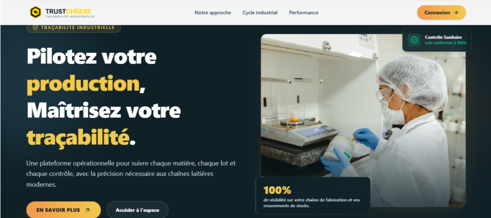
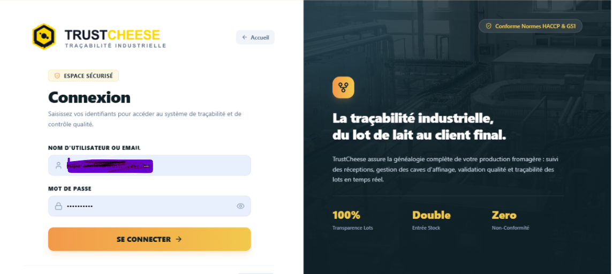

# 🧀 TrustCheese : Système de Traçabilité Agroalimentaire

<p align="center">
  
</p>
TrustCheese est une application web industrielle développée pour la gestion et la traçabilité de bout en bout des produits dans l'industrie fromagère (Abrar Food Industrie). Elle couvre l'intégralité du cycle de fabrication : de la réception des matières premières à la livraison, en passant par la transformation, le contrôle qualité et l'affinage.

---

## Fonctionnalités Principales

* **Gestion du cycle de production :** Réception des matières premières, suivi des mouvements de stock, gestion des cuves, affinage et conditionnement des produits finis.
* **Traçabilité événementielle :** Historique chronologique complet de chaque lot (date, type d'opération, responsable, paramètres techniques)[cite: 2.2, 2.4].
* **Traçabilité publique par QR Code :** Génération automatique de QR Codes par lot permettant au consommateur final d'accéder aux informations de fabrication et de qualité du fromage[cite: 2.2, 2.4].
* **Sécurité & Contrôle d'accès (RBAC) :** Authentification sécurisée via Spring Security + JWT (cookies HttpOnly) avec des rôles spécifiques (*Opérateur, Qualité, Logistique, Manager, Admin*).
* **Contrôle Qualité :** Enregistrement des données d'analyse et de conformité aux étapes clés de la production[cite: 2.2, 2.4].

---
## Aperçu du plateforme


## Stack Technique

### **Back-End**
* **Langage :** Java 17
* **Framework :** Spring Boot (Spring Data JPA, Spring Security)[cite: 2.2, 2.4]
* **Base de données :** PostgreSQL[cite: 2.2, 2.4]
* **Sécurité :** JWT (JSON Web Tokens)

### **Front-End**
* **Framework / Librairie :** React (avec Vite)[cite: 2.4]
* **Langage :** JavaScript / TypeScript

### **DevOps & Outils**
* **Containerisation :** Docker / Docker Compose[cite: 2.2]
* **Contrôle de version :** Git & GitHub[cite: 2.2]

---

## Structure du Projet

```text
trustcheese/
├── backend/            # Code source du Back-End (Spring Boot)
│   ├── src/
│   └── pom.xml
├── frontend/           # Code source du Front-End (React + Vite)
│   ├── src/
│   └── package.json
├── docker-compose.yml  # Fichier de déploiement multi-conteneurs
└── README.md           # Documentation du projet
